# BuildLead CRM

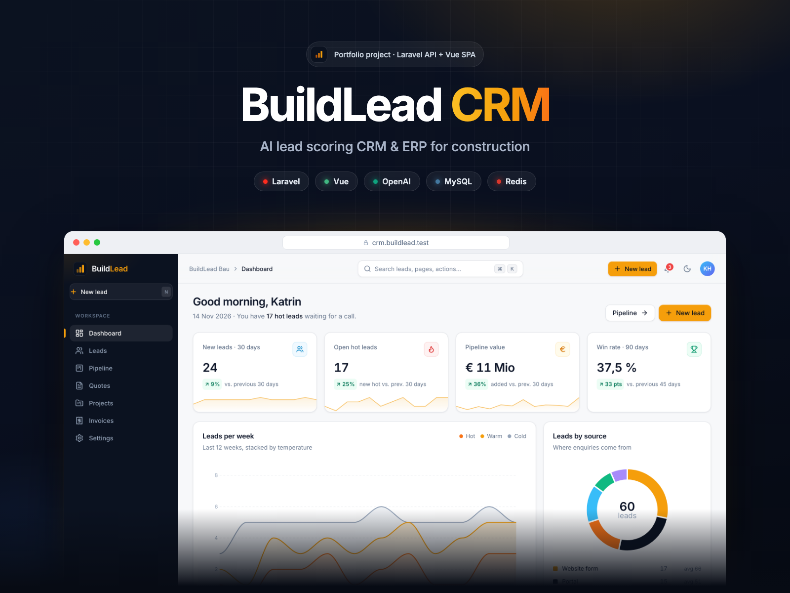

AI lead-scoring CRM plus light ERP for construction companies. The demo company is BuildLead Bau GmbH in Berlin.

Each lead is scored 0–100 by rules plus OpenAI, labelled Hot, Warm or Cold, and auto-assigned to the best sales rep. From there it moves through the pipeline: quote, project, invoices.

```
backend/    Laravel API (Sanctum, MySQL, Redis queues)  → see backend/README.md
frontend/   Vue 3 SPA (Vite, Tailwind, Pinia)            → see frontend/README.md
docs/       postman/ collection, website-form.html, screenshots, video, diagrams
```

The full spec and design rules are in [PROJECT_SPEC.md](PROJECT_SPEC.md).

## Demo

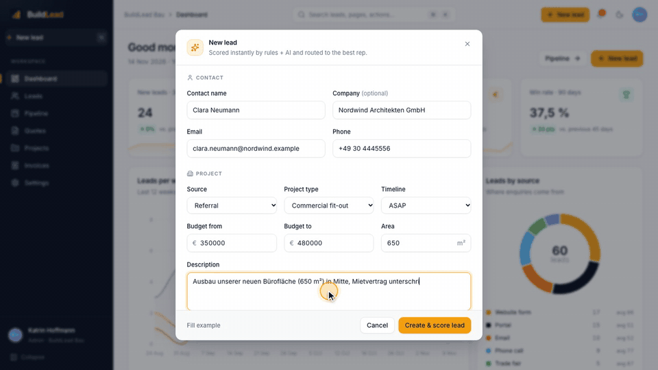

▶ **[Full 75-second walkthrough (MP4, 1080p)](docs/video/buildlead-demo.mp4)**: login → dashboard → ⌘K → new lead scored Hot → AI breakdown → pipeline drag → quote → projects → AI settings.

| | |
|---|---|
| 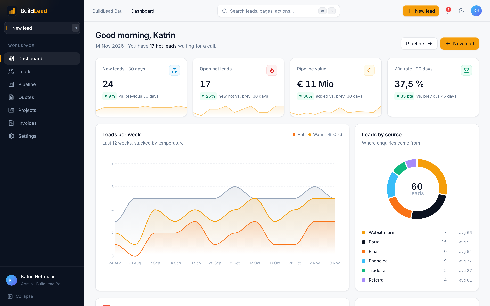 **Dashboard** | 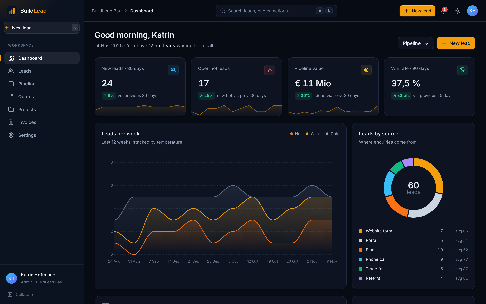 **Dark mode** |
| 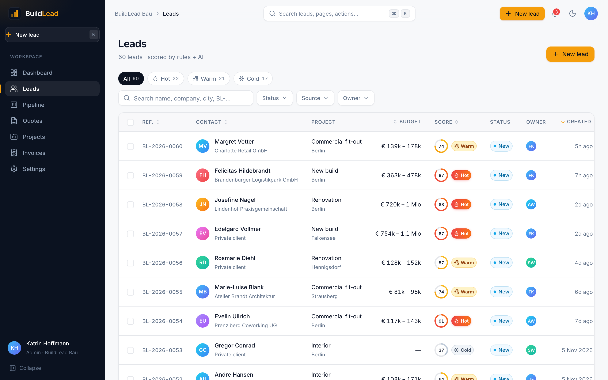 **Leads** | 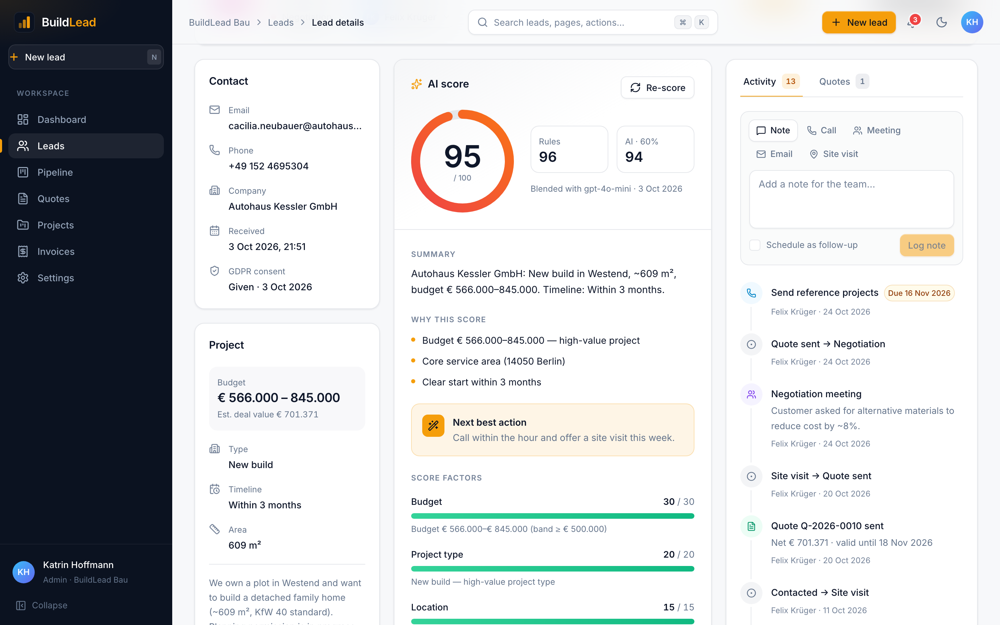 **AI score breakdown** |
| 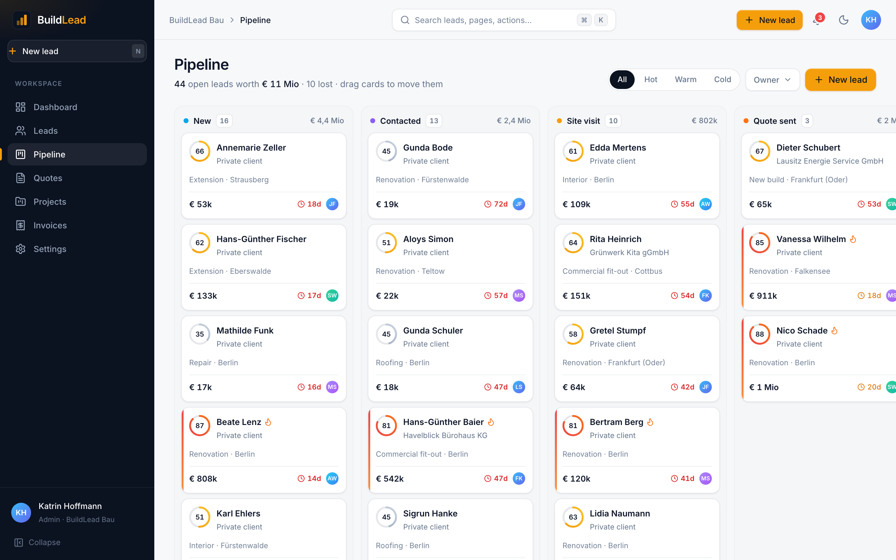 **Pipeline** | 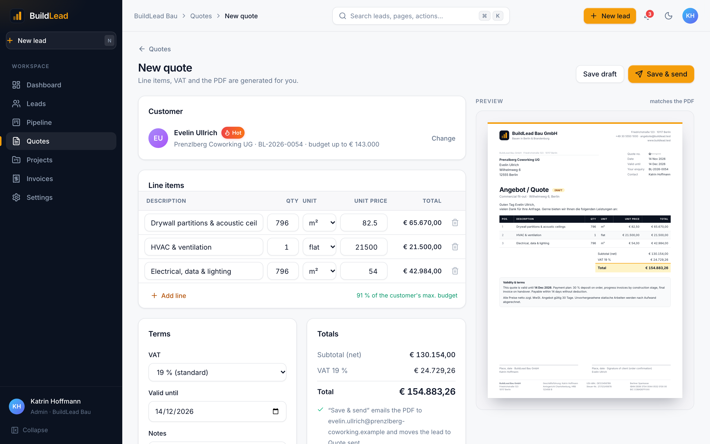 **Quote builder** |
| 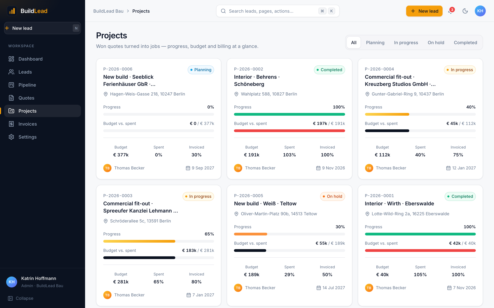 **Projects** | 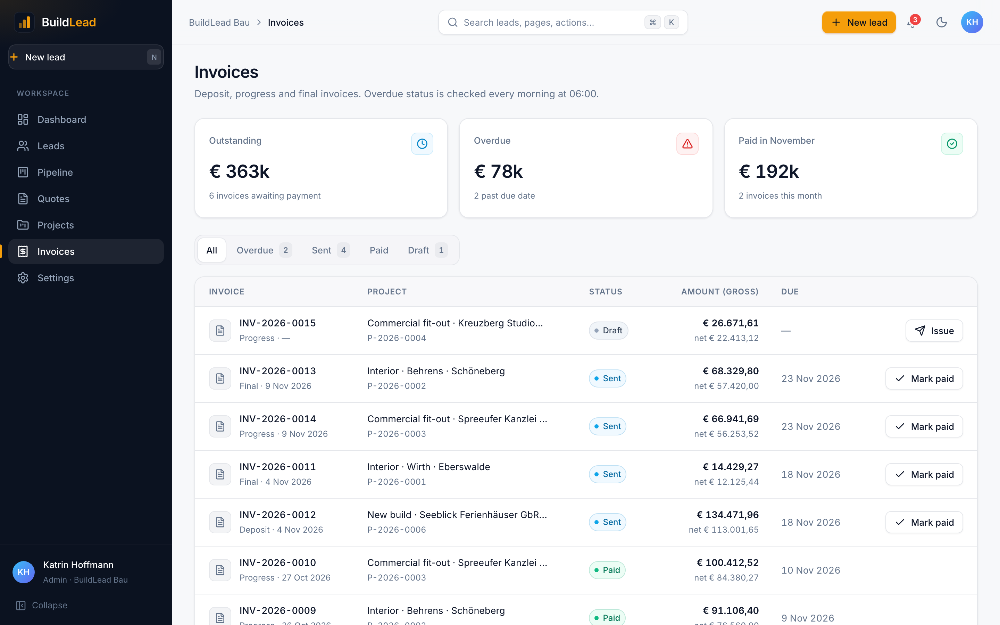 **Invoices** |
| 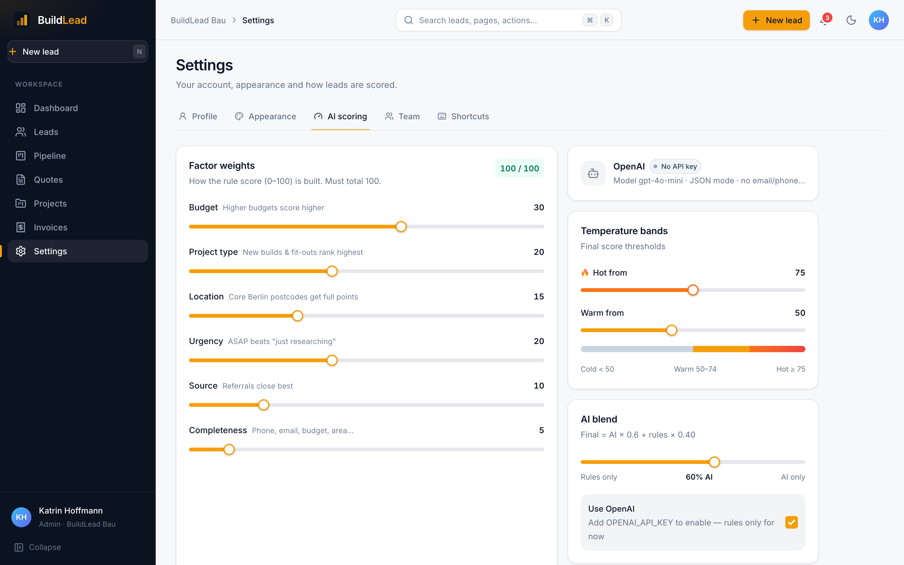 **AI scoring settings** | 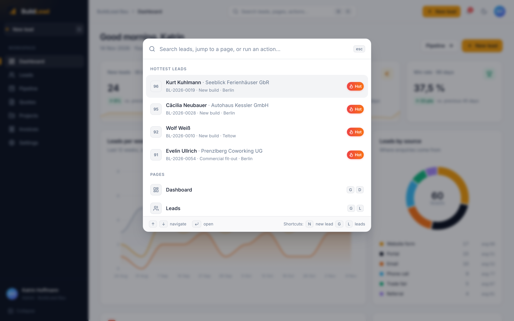 **⌘K command palette** |
| 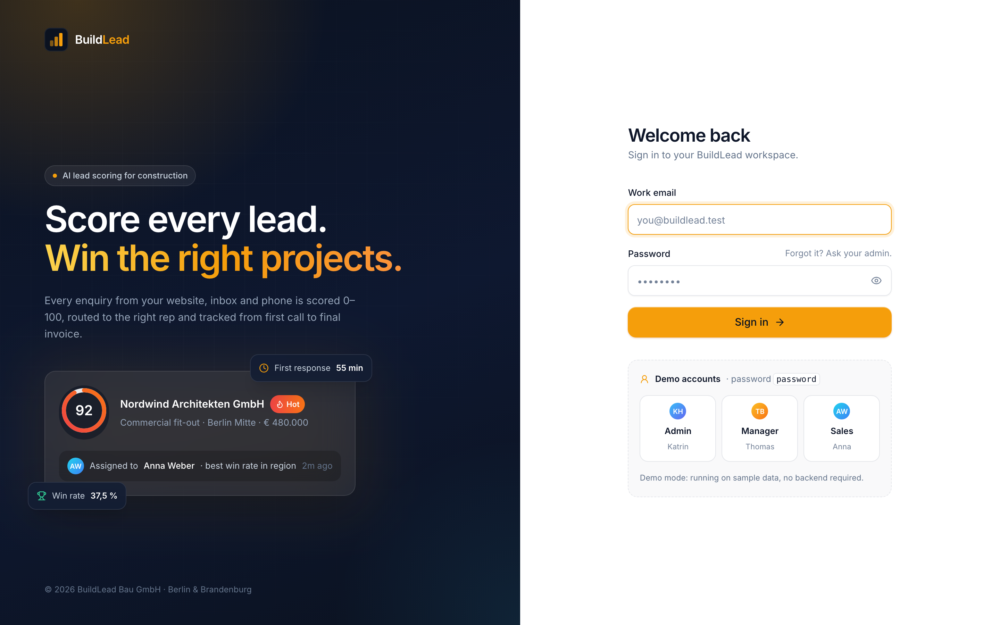 **Login** | 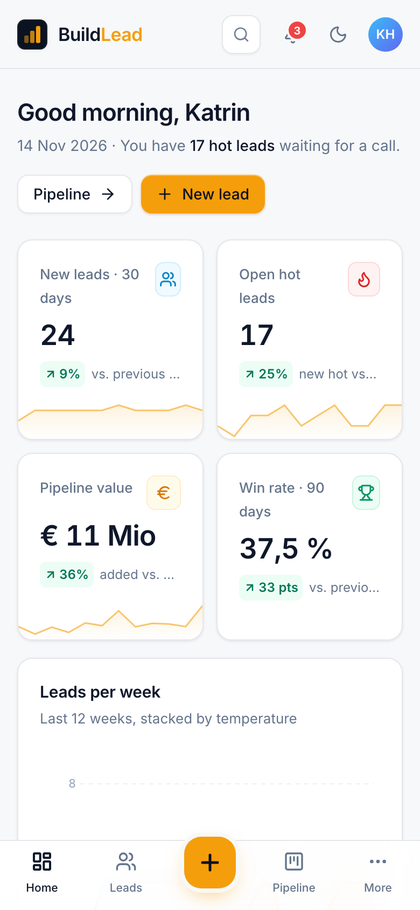 **Mobile** |

## Architecture

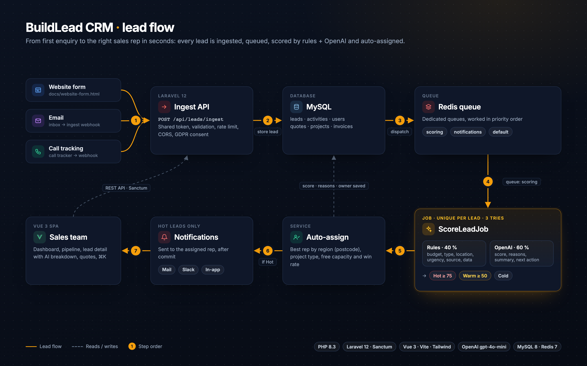

All media is generated from the demo-mode SPA by the scripts in [docs/media-src](docs/media-src).

## Run locally

### Option A: Docker (one command)

Needs Docker Desktop (or any Docker Engine with Compose v2).

```bash
docker compose up --build
```

| Service | What it runs | URL / port |
|---|---|---|
| `node` | Vue SPA dev server (Vite); proxies `/api` to the API | http://localhost:5190 |
| `api` | Laravel API (`php artisan serve`); migrates and seeds the demo company on first start | http://localhost:8020/api |
| `queue` | `queue:work redis --queue=scoring,notifications,default` (AI scoring, hot lead alerts, emails) | — |
| `scheduler` | `schedule:work` (marks overdue invoices daily at 06:00 Europe/Berlin) | — |
| `mysql` | MySQL 8.4, database `buildlead` (user and password both `buildlead`) | `localhost:3307` |
| `redis` | Redis 7 (queues and cache) | — |

The first start takes a minute or two (composer and npm installs, migrations, seed). Then open http://localhost:5190 and sign in as `admin@buildlead.test` with password `password`.

- Code in `backend/` and `frontend/` is bind-mounted, so edits reload live. Restart `queue` after changing job code: `docker compose restart queue`.
- AI scoring is optional. Run `OPENAI_API_KEY=sk-… docker compose up` to enable it; without a key, leads are scored by rules only.
- Fresh demo data: `docker compose exec api php artisan migrate:fresh --seed`.
- Reset everything, including the database: `docker compose down -v`.

### Option B: native (PHP 8.3, Composer, Node 20+, MySQL 8 or Postgres, Redis optional)

Run each process in its own terminal.

**1. Backend API** on port 8020

```bash
cd backend
composer install
cp .env.example .env && php artisan key:generate
# .env: set DB_* for your MySQL/Postgres database. Without Redis, set QUEUE_CONNECTION=database
php artisan migrate:fresh --seed
php artisan serve --port=8020
```

**2. Queue worker**, needed for lead scoring, hot lead alerts and quote emails

```bash
cd backend
php artisan queue:work --queue=scoring,notifications,default --tries=3
```

Optional third backend process: `php artisan schedule:work` (daily overdue-invoice check).

**3. Frontend** on port 5190

```bash
cd frontend
npm install
npm run dev          # real API: /api is proxied to http://127.0.0.1:8020
npm run dev:demo     # or: no backend at all, realistic in-memory sample data
```

Open http://localhost:5190. All demo accounts use the password `password`:

| Role | Login | Sees |
|---|---|---|
| Admin | `admin@buildlead.test` | everything, plus AI scoring settings |
| Manager | `manager@buildlead.test` | all leads, projects, invoices, team |
| Sales | `lukas.schneider@buildlead.test` (and 5 more in [backend/README.md](backend/README.md)) | own leads, pipeline and quotes only |

**Checks**

```bash
cd backend && php artisan test     # 229 tests (SQLite in-memory)
cd frontend && npm run build       # production build, no warnings
```

## Status

| Phase | Scope | State |
|---|---|---|
| 1 | Backend foundation: schema, models, enums, scoring config, auth, demo data | ✅ done |
| 2 | AI scoring engine: rules + OpenAI blend, auto-assignment, hot lead alerts, `leads:rescore` | ✅ done |
| 3 | Core API: ingest webhook, leads CRUD, pipeline, dashboard, CORS, Postman collection, example website form | ✅ done |
| 4 | ERP: quotes (PDF, email, accept → project), projects, invoices (110 % cap, overdue job, PDF), scoring settings API | ✅ done |
| 5 | Vue 3 SPA: design system, app shell, ⌘K palette, shortcuts, new-lead flow, demo mode, all pages | ✅ done |
| 6 | Dashboard charts & call list, leads list with bulk actions, lead detail page with AI score, timeline and quotes | ✅ done |
| 7 | Pipeline board, quote builder with live PDF preview, project detail & invoicing, invoices, AI scoring & team settings, palette | ✅ done |
| 8 | Real-API polish: error and retry states, session expiry, role-based menus and guards, responsive pass at 1440/1024/768/390, dark mode, keyboard and focus, Docker Compose | ✅ done |
| 9 | Portfolio media: screenshots, cover, architecture diagram, 75 s demo video + GIF (reproducible scripts in `docs/media-src`) | ✅ done |
